<p align="center">
  
</p>

# mddbmeta

**mddbmeta reads the files an MD project already produced and writes the MDDB-workflow `inputs.yaml` you would otherwise type by hand, with a record of where every value came from.**

MDDB-workflow (`mwf`) standardizes and analyzes simulations for the MDDB, but the simulation fields of its inputs file are typed by hand. Its own template says of them: *"Someday this will be automatically mined."* Those fields are `program`, `version`, `framestep`, `timestep`, `temp`, `ensemble`, `ff`, `wat` and `boxtype`. `mwf` also merges trajectory parts in whatever order they are listed, and glob order is filesystem order.

mddbmeta:

- reconstructs the project as **Project → Replica → Phase → Step** from the engine's own control files and logs;
- mines the MDDB fields, recording a value, unit, source file and location, method, and confidence (`exact` / `derived` / `heuristic`) for each;
- orders each replica's production trajectories by **restart lineage**, not by name, and checks the joins;
- reports gaps, overlaps, missing chunks, crashed runs, frame-count and atom-count mismatches as findings with stable codes;
- writes an `inputs.yaml` that passes MDDB-workflow's schema, plus a provenance sidecar; it can also fill or reconcile an existing inputs file.

Supported engines:

- **AMBER** (sander / pmemd);
- **GROMACS** (gmx mdrun);
- **NAMD** (2.x / 3.x, CHARMM psf or `amber on` prmtop);
- **OpenMM** (Python run scripts, read statically);
- **MELD** (replica exchange on OpenMM).

No MD engine needs to be installed. mddbmeta only reads files: it never executes a run script and never unpickles anything.

- Python ≥ 3.10, no required dependencies (extras: `yaml`; `netcdf` for AMBER NetCDF files and MELD data stores)
- License: Apache-2.0 (see `LICENSE`)

## Install

On HiPerGator:

```bash
module load python/3.11
git clone https://github.com/ImeCMR/mddbmeta.git
cd mddbmeta
python -m venv .venv
.venv/bin/pip install -e ".[yaml,netcdf]"
.venv/bin/mddbmeta --version
```

Elsewhere, `python -m pip install -e ".[yaml,netcdf]"` in any Python ≥ 3.10 environment. scipy also works as the NetCDF backend for AMBER files, but MELD data stores need netCDF4.

## Quickstart

```bash
mddbmeta discover runs/                         # what was run, per replica, with the mined fields
mddbmeta validate runs/ --strict                # findings only; exit 2 on errors (and warnings with --strict)
mddbmeta export runs/ --mddb runs/inputs.yaml   # MDDB inputs + runs/inputs.yaml.mddbmeta.json
mwf run -dir runs                               # MDDB-workflow picks up inputs.yaml
```

Example (two replicas that fork from a shared equilibration):

```text
$ mddbmeta discover runs/
Shared steps (no replica): prep/equil, prep/heat, prep/min

Replica rep1  [dir: rep1]  -> mdir rep1
  production     rep1/prod_0001  <- prep/equil      traj rep1/prod_0001.nc (10 frames)
  production     rep1/prod_0002  <- rep1/prod_0001  traj rep1/prod_0002.nc (10 frames)
  merge order: rep1/prod_0001.nc, rep1/prod_0002.nc
...
MDDB fields:
  program     AMBER          exact     engine log header (PMEMD)  rep1/prod_0001.mdout:header (+3)
  timestep    2.0            exact     stated; ps->fs             rep1/prod_0001.mdin:&cntrl:dt (+3)
  framestep   0.001          exact     median time delta; ps->ns  rep1/prod_0001.nc:median(diff(time)) (+3)
  temp        300.0          exact     stated                     rep1/prod_0001.mdin:&cntrl:temp0 (+3)
  wat         TIP3P          derived   build log                  tleap.in:leaprc water
  ff          Amber ff14SB   derived   build log (linked to topology)
```

### What you still write by hand

mddbmeta fills the simulation fields:

- `program`, `version`, `type`, `framestep`, `timestep`, `temp`, `ensemble`, `ff`, `wat`, `boxtype`;
- `input_topology_filepath` / `input_structure_filepath`;
- `mds[]`, `mdref`;
- for MELD, also `method` and `metadditions`.

Project metadata is not in any run file, so add it to `inputs.yaml` yourself:

| Field | Required? | Notes |
|---|---|---|
| `name`, `description` | yes | shown on the MDDB overview page |
| `authors`, `groups`, `contact` | yes | check existing MDDB spellings to avoid duplicates |
| `citation` | recommended | `(br)` for a line break |
| `pdb_ids` | recommended | e.g. `[1KH0]`; MDDB-workflow pulls extra data from the PDB |
| `method` | for non-MELD runs | e.g. `Classical MD` |
| `license` / `linkcense` | optional | defaults to CC-BY 4.0 |
| `forced_references` | optional | UniProt IDs; `noref` for synthetic or mutant chains |
| `ligands`, `interactions`, `chainnames`, ... | optional | analysis and display settings; see `mwf inputs` |

**Tip:** keep the fields that are the same for every project (`authors`, `groups`, `contact`, `license`) in one `lab.yaml`. Then let mddbmeta fill in the rest:

```bash
cp lab.yaml runs/inputs.yaml
mddbmeta export runs/ --fill runs/inputs.yaml --in-place --add-mds
```

Don't edit mined values in `inputs.yaml` directly. Use `overrides:` (below) so the provenance stays correct, then check with `mddbmeta reconcile runs/inputs.yaml`.

### Working with an existing inputs file

```bash
mddbmeta reconcile runs/inputs.yaml             # agree / fill / conflict per field; exit 3 on conflicts
mddbmeta export runs/ --fill runs/inputs.yaml --in-place   # fill empty fields only (keeps a .bak)
```

`reconcile` expands your `input_trajectory_filepaths` the way `mwf` does: globs, then the MD directory, the project directory and the cwd. It compares the resulting merge order with the continuity chain, and reports a mismatch as `ORDER002`. `--fill` never overwrites a value you set and never reorders your trajectory list.

### Correcting what discovery got wrong

```bash
mddbmeta discover runs/ --write runs/project.yaml
```

Edit the `overrides:` block, then use `runs/project.yaml` wherever a directory is accepted:

```yaml
overrides:
  wat: OPC                                             # an MDDB field
  mds.rep2.temp: 310                                   # a per-MD field
  steps.rep1/prod_0003.role: equilibration             # a step's role
  replicas.rep1.production_chain: [rep1/prod_0001, rep1/prod_0002]
```

The manifest's `snapshot` is regenerated from the run files on every load, so it can't go stale. Only the `discovery` options and the `overrides` are read back.

### Replica layouts

Replicas are inferred from one directory level: `rep1/ rep2/`, `replica_1/`, `run01/`, `seed3/`, `01/`, or sibling directories with nearly identical contents. A name token also works (`rep1_prod_001`). Directories beside them (`prep/`, `common/`) hold shared steps. Ambiguous layouts such as `300K/rep1` are refused with `REP001` rather than guessed; declare them instead:

```bash
mddbmeta export runs/ --replica-glob '*/rep*' --mddb runs/inputs.yaml
```

### Batch use with `mwf dataset`

```bash
mwf dataset inputs mwf_ds.sql -it "$(mddbmeta template-path)" -ig "$(mddbmeta generator-path)"
```

The generator returns YAML-encoded strings, so Jinja never prints `None` or Python reprs. Use `mddbmeta_block` for all mined keys, or `framestep_yaml`, `temp_yaml`, `mds_yaml`, ... in your own template. Knobs: `MDDBMETA_REPLICA_GLOB`, `MDDBMETA_ACCEPT_HEURISTIC=1`, `MDDBMETA_NO_SIDECAR=1`.

## How each field is mined (AMBER)

| MDDB field | Rule | Typical confidence |
|---|---|---|
| `program` | `AMBER` when a log header names SANDER/PMEMD (executable in the note); else a NetCDF `program` attribute written by pmemd/sander | exact / derived |
| `version` | log header release; all production runs must agree (`CONS003`) | exact |
| `timestep` | `dt` × 1000 fs across production runs | exact (stated) / derived (default) |
| `framestep` | frame interval of the trajectories themselves (median time delta), cross-checked with `ntwx × dt` (`CONS002`), in ns | exact |
| `temp` | `temp0` of thermostatted production runs; per MD if replicas differ (`MINE003`) | exact |
| `ensemble` | NVE / NVT / NPT / NPH from `ntt`, `ntb`, `ntp` | derived |
| `boxtype` | topology box flag plus restart box angles: Cubic, Rectangular, Truncated Octahedron, Triclinic; omitted if non-periodic | derived |
| `wat` | tleap `leaprc.water.*` (derived); else residue name / site-count heuristic, written only with `--accept-heuristic` | derived / heuristic |
| `ff` | tleap `leaprc.*` in a build log that saved this topology (derived); an unlinked log is heuristic | derived / heuristic |
| `type` | `trajectory` when every replica has a production trajectory | derived |
| `mds[]` | one per replica: `name`, `mdir`, and `input_trajectory_filepaths` in chain order | — |
| `input_topology_filepath` | project level if all replicas share it, otherwise per MD | exact |

Each parameter is resolved in this order:

1. stated in the mdin (`stated`);
2. reported by the engine in the mdout "CONTROL DATA" section (`engine_report`), which is what actually ran;
3. the documented AMBER default (`engine_default`, derived).

A value nothing states is `null`, never a parser default.

Only `exact` and `derived` values are written. `heuristic` guesses stay in the sidecar and in `MINE002` suggestions unless you pass `--accept-heuristic`.

## How each field is mined (GROMACS)

| MDDB field | Rule |
|---|---|
| `program` / `version` | mdrun log banner and `GROMACS version:`, e.g. `2022.3` (the full build string goes in the note) |
| `timestep`, `temp`, `ensemble` | the log's resolved *Input Parameters*: `dt`, `ref-t` (per coupling group), `integrator`/`tcoupl`/`pcoupl`. These are what ran, after grompp and any `convert-tpr`. The .mdp adds grompp-only options such as `define = -DPOSRES` and `gen-vel` |
| `framestep` | frame times of the xtc/trr (median delta), cross-checked with `nstxout-compressed × dt` |
| `boxtype` | box vectors from a .gro: Cubic, Rectangular, Dodecahedron, Truncated Octahedron, Triclinic |
| `ff`, `wat` | `#include "<ff>.ff/forcefield.itp"` and the water `.itp` in the .top (derived) |
| topology | the run's `.tpr` (from the log's `-s`/`-deffnm`), per MD when replicas have their own |

GROMACS does not record which coordinates `grompp` read. Continuations are therefore taken from evidence mdrun does record:

- **`mdrun -cpi`:** "Reading checkpoint file X" and its time, matched to the run that wrote X.
- **Energy fingerprints:** a run continued with `grompp -t prev.cpt` starts in exactly the state the previous run ended in. Its step-0 energy terms equal the previous run's last record, within one unit of the last printed digit. Every such inference is announced (`LIN003`).

Appended logs (`mdrun -cpi` without `-noappend`) are one step with several sessions. `-noappend` parts (`prod.part0003.log`) are separate steps linked to the run they continue.

## How each field is mined (NAMD)

NAMD's log prints its resolved configuration as `Info:` lines. That includes values a config computed with Tcl, such as `firsttimestep [get_first_ts prod.restart.xsc]`, so mddbmeta never evaluates Tcl. Configs are still read, with `set`/`$var`/`source`, for runs that have no log yet.

| MDDB field | Rule |
|---|---|
| `program` / `version` | `Info: NAMD 2.14b1 for <platform>` |
| `timestep` | `Info: TIMESTEP` (fs) |
| `temp` | `LANGEVIN TEMPERATURE` (or stochastic-rescaling / Lowe-Andersen / tCouple). If the run changed it with Tcl (`TCL: Setting parameter langevinTemp to ...`), the last value, and the step is flagged as a ramp |
| `ensemble` | thermostat and barostat flags (`LANGEVIN PISTON`, `BERENDSEN`, `MONTE CARLO` pressure control) |
| `framestep` | dcd header: `NSAVC × DELTA` (DELTA is in AKMA units, 48.88821 fs) |
| `boxtype` | `PERIODIC CELL BASIS` vectors; an `amber on` prmtop's box flag when non-periodic |
| `ff` | CHARMM parameter files named in the log (`par_all36m_prot` → CHARMM36m, ...). CHARMM-GUI loads every family, so lipid, nucleic, carbohydrate and CGenFF labels are only listed when the psf contains such residues |
| `wat` | CHARMM water/ion stream file plus `TIP3` residues → TIP3P (CHARMM's modified TIP3P) |
| topology / structure | the psf (or prmtop), plus the `COORDINATE PDB` as `input_structure_filepath` |

Continuations are exact. A run's `BINARY COORDINATES` is another run's final output (`<outputName>.coor`) or its restart (`<restartName>.coor`). The run clock is `FIRST TIMESTEP × TIMESTEP`, so segments without `firsttimestep` are reported as clock resets (`CONT005`). A run that died still prints `WallClock` and "End of program". mddbmeta checks for `FATAL ERROR` lines instead.

## How each field is mined (OpenMM)

An OpenMM run is a Python script, so mddbmeta reads it with `ast` and **never executes it**. Only literals, arithmetic and OpenMM unit expressions (`300*kelvin`, `0.002*picoseconds`, `1/picosecond`) are evaluated.

- **Each StateDataReporter log (CSV) is one step.** The log is matched to the script whose `StateDataReporter(...)` file template fits it (`f'prod_{i}.csv'`, or a stdout log with the script's name). The placeholder values (`i=2`) then name the segment's trajectory, checkpoints and saved states, and the file it loaded (`f'prod_{i-1}.chk'` → `prod_1.chk`).
- **Continuations:**
  - a `loadState`/`loadCheckpoint` target is another segment's `saveState`/`saveCheckpoint`/`CheckpointReporter` output;
  - a segment with no reload continues the previous segment of the same script, for example NVT → NPT;
  - with `Modeller` (solvent, hydrogens), the starting structure is the PDB the script wrote, not its building input.
- **Settings:**
  - the integrator and its arguments (Langevin/Nosé-Hoover/Brownian, or Verlet + `AndersenThermostat`), the barostat, `createSystem` options, `setTemperature` ramps and restraints (`CustomExternalForce`), all read from the script;
  - serialized `System`/`Integrator` XML files the script loads take precedence over the script;
  - the timestep from the log's own Time/Step columns beats the script, with the disagreement noted.
- **Version:** `openmmVersion` of the `State`/`System` XML the run wrote or read.
- **Force field and water:**
  - the `ForceField('amber14-all.xml', 'amber14/tip3pfb.xml')` files: Amber ff14SB, TIP3P-FB;
  - OpenFF/GAFF template generators.
- **Frames:** OpenMM's DCD/XTC reporters count time from their own creation, not the simulation clock, so frame times are shifted onto the run clock.
- **Topology:**
  - `AmberPrmtopFile`/`CharmmPsfFile`/`GromacsTopFile` inputs are adopted from the other adapters;
  - a system built from a PDB + `ForceField` XML has no topology file, so the export writes mwf's `input_topology_filepath: 'no'` flag plus the PDB as the structure, and says what that costs (`MINE004`).

## MELD (replica exchange)

A MELD run is one replica-exchange simulation. After the run, `extract_trajectory extract_traj_dcd --replica i` writes ladder position *i*, and `follow_dcd` writes walkers.

**What becomes an MD**
- Each extracted **ladder DCD** becomes one MD of `type: ensemble`, with no `framestep`: its frames are ladder members, not a time series.
- **Walkers** are recorded but not exported (`MELD003`), since each one crosses temperatures and restraint strengths.

**Where the settings come from**
- **The setup script**, read statically and never executed:
  - `N_REPLICAS` / `N_STEPS`;
  - `RunOptions(timesteps=...)`, the MD steps per exchange;
  - `GrappaOptions` / `AmberOptions`, which give the force fields, the solvation, and the timestep. MELD's builders use 2.0 fs, or 3.5 fs with `use_big_timestep`, or 4.5 fs with `use_bigger_timestep`;
  - the temperature scaler and the adaptor.
- **The leader log** `Logs/remd_000.log`: versions, completion, and restarts (`MELD004`).
- **The data store's `alphas`** in `Data/Blocks/block_*.nc`, which records every ladder position's alpha at every frame. Each MD's `temp` is its final alpha put through the scaler.
  - If an adaptor moved the ladder, `MELD001` lists the positions whose temperature changed and the frame where it settled.
  - Extracted and stored frame counts are compared (`MELD002`).
- **Never unpickled:** `Data/*.dat` files are pickles and are never opened.
- **`metadditions.meld`** records the replica count, exchanges, MD steps and interval per exchange, the ladder, the adaptor, the Grappa model and the solvent model.

**About temperatures:** each MD's `temp` is the temperature of its ladder position at the end of the run. If an adaptor such as `EqualAcceptanceAdaptor` moved the ladder, this differs from the initial ladder in your setup script. `MELD001` tells you when that happened, and the sidecar JSON holds each position's full temperature range. Positions above the scaler's `alpha_max` share its top temperature and differ only in restraint strength.

**Reading the data store**
- It needs the `netcdf` extra (netCDF4), because MELD blocks are HDF5.
- It is the slow part, reading one small variable per block: about 2–3 minutes for 400 blocks on /orange.

### How MDDB-workflow merges the parts (`MRG001`, `ORDER002`)

MDDB-workflow merges trajectory parts with MDTraj's `mdconvert -o out part1 part2 ...`. This applies to xtc, trr, dcd and nc; it is the first merge function mwf's converter accepts. mdconvert concatenates every frame **in list order**. Verified on the real GROMACS and NAMD fixtures:

- **Order is everything.** A wrong `input_trajectory_filepaths` order silently scrambles the trajectory. `reconcile` checks it against the continuity chain (`ORDER002`), and `export` writes the chain order.
- **Nothing is dropped.** Parts whose clock restarts at 0 (`grompp -t` chains, NAMD runs without `firsttimestep`) are kept whole. Their times are just non-monotonic in the merged file, and MDDB uses `framestep`, not stored times. The clock reset is reported as `CONT005` for provenance: a warning inside production, info between preparation stages.
- **Shared boundary frames are duplicated.** A GROMACS `-noappend` continuation starts by re-writing the previous part's last frame, which then appears twice in the merged trajectory. This is reported as `MRG001` (a warning; export still proceeds).

## What gets checked

The full code list with severities is in [`docs/findings.md`](docs/findings.md).

- **Continuity:** each step's start time against the time stored in the restart it read (`CONT000` healthy, `CONT001` gap, `CONT003` overlap). The tolerance is max(0.1 ps, half a frame interval). Every join of the production chain is also checked at trajectory level, since those frames are what `mwf` concatenates.
- **Sequences:** holes and duplicates in numbered families, per replica (`SEQ001`/`SEQ002`).
- **Completeness:** a missing trajectory (`CMP001`); an unfinished run (`CMP002`, an error if a later run continues from it); a frame count that disagrees with the log (`CMP003`).
- **Consistency:** production runs disagreeing on dt, ntwx, temp0 or ensemble (`CONS001`); atom counts disagreeing across topology, log, coordinates and trajectory (`CONS004`).
- **Schema:** exports are checked against a stdlib mirror of MDDB-workflow's inputs schema (`SCH001`). The test suite also validates them against MDDB-workflow's real pydantic schema source.

## Known limitations

- **OpenMM:**
  - scripts are read without running them, so file names built at run time (beyond f-strings, `+` and `os.path.join`) and branching logic are resolved heuristically;
  - a run without a StateDataReporter log produces no step;
  - CHARMM-GUI's `openmm_run.py` + `.inp` layout is not handled specially.
- **MELD:** `temp` is the final ladder temperature (see above). Restraint strength (alpha) is not written per MD.
- **NAMD:** replica-exchange (`+replicas`) and multi-copy runs are not modelled. Configs that loop over `run` inside Tcl blocks rely on the log for their totals.
- **GROMACS:**
  - only the tpr header is read, so a run with no log contributes a topology but no settings;
  - `-multidir` runs are read as independent directories.
- **AMBER:**
  - REMD / groupfile inputs (several `&cntrl`) are reported (`ENG002`), not modelled;
  - force fields are only known when a tleap script or log is present.
- **ASCII mdcrd:** frame counts need the atom count, taken from the log or topology.
- **Analysis output:** files left in the project folder can be mistaken for run files, e.g. cpptraj cluster trajectories reported as AMBER files (`ENG001`). Exclude them with `--exclude`, or ignore the warning if the mined values look right.

## Testing it and reporting problems

1. Run `mddbmeta discover <dir> -v` on one of your own projects and check every mined value against what you know you ran.
2. Run `mddbmeta export <dir> --mddb <dir>/inputs.yaml`, add the hand-written fields, and run `mddbmeta reconcile <dir>/inputs.yaml`.
3. If something is wrong or missing, open an issue on the GitHub repository. Include:
   - the engine and how the run was set up;
   - the `discover -v` output;
   - the field that is wrong, and what it should be.

   Please don't attach large trajectories.

Contributors: see [`docs/development.md`](docs/development.md).
